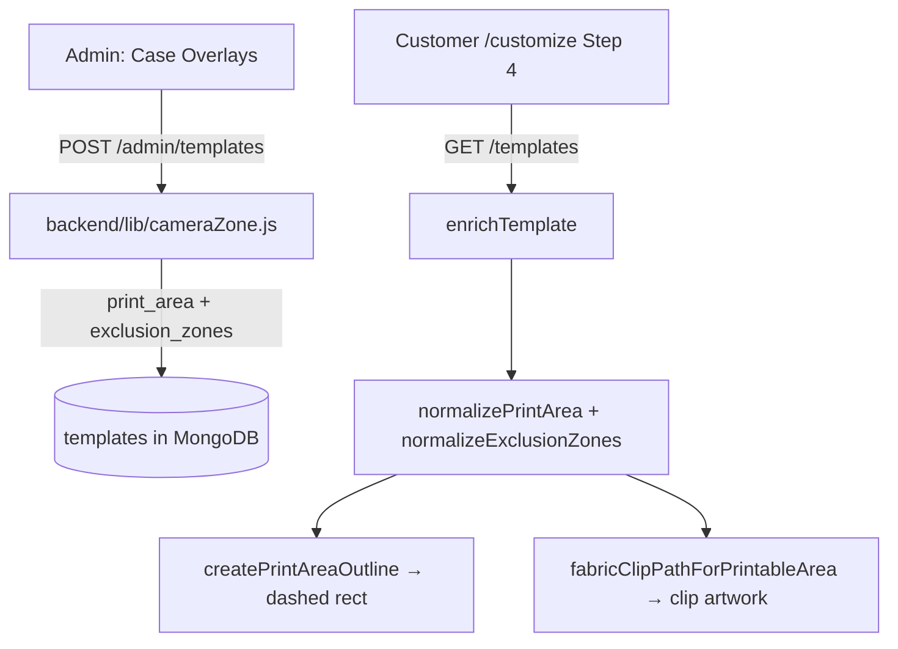

# Print Area & Mask Zones — README

How the print/mask zone system works on the Customize canvas, and the bug fix for the
"partial top-left-only outline".

---

## What these are

| Term | Meaning | Stored on template |
|------|---------|--------------------|
| **Print area** | The rectangle where customer artwork is allowed to print | `print_area: { x, y, width, height, rx, ry }` |
| **Mask / exclusion zones** | Holes inside the print area where art must NOT print (camera, flash, sensor) | `mask_zones` / `exclusion_zones` (rect or circle) |
| **Camera zone** | Legacy single-zone field | `camera_zone` |
| **Canvas size** | Native pixel size of the overlay PNG | `canvas_width`, `canvas_height` |

All coordinates are in **template (canvas) pixels**, not screen pixels. The Fabric canvas is
zoomed to fit, so zones scale automatically.

---
the print ,ask zone system works on the Customize canvas abd the bug fix for the site 
## Files

| File | Role |
|------|------|
| `frontend/src/lib/caseTemplate/` | Modular yourPrint-style renderer (see below) |
| `frontend/src/lib/cameraZone.js` | Normalizes zones, builds outline + clip paths (Fabric) |
| `frontend/src/pages/Customize.jsx` | Steps 1–3 + thin DesignStep shell |
| `frontend/src/components/ZoneEditor.jsx` | Admin zone drawing UI |
| `backend/lib/cameraZone.js` | Parses/normalizes zones on upload, `enrichTemplate` |
| `backend/lib/printComposite.js` | 300 DPI print (print area − masks; no overlay/guide) |

### Case template modules (`frontend/src/lib/caseTemplate/`)

| Module | Role |
|--------|------|
| `TemplateRenderer` | Orchestrates layers + viewport |
| `TemplateLoader` | `GET /templates` + normalize |
| `CanvasViewport` | Fit-to-canvas (template coords, not screen px) |
| `ArtworkLayer` | Move / scale / rotate / wheel / pinch / double-click reset |
| `OverlayLayer` | Case PNG above artwork |
| `GuideLayer` | Blue dashed print guide (edit mode only) |
| `ClipPathFactory` | Print area − exclusion zones |
| `ExportRenderer` | Preview (no guide) + print payload (no overlay) |

**Layer order:** artwork → overlay PNG → print guide (edit only).

---

## Data flow



---

## The bug (partial top-left outline)

The outline only showed the **top-left corner + short top/left edges**. Two causes:

1. **Wrong stacking order** — the outline was drawn *under* the opaque case PNG. The full
   rectangle existed, but the black case covered it; only a transparent top-left fringe
   showed through, looking like a broken border.
2. **Zero-size rect** — a `fabric.Rect` with `left/top/rx` but **missing `width`/`height`**
   renders as a `0×0` shape that strokes only a tiny top-left arc. This happened when
   `print_area` / zone dimensions were `undefined` or `0`.

Legacy zone data (`type: "camera"`, `shape: "circle"`) was also being dropped by the old
normalizer, so some masks never rendered at all.

## The fix

- **Draw the outline on top** of the case PNG:

```javascript
c.add(guide);
c.bringObjectToFront(guide); // above the case PNG so the full rect is visible
```

- **Validate dimensions** before drawing; warn loudly instead of drawing a broken shape:

```javascript
const checked = validateRectArea(printArea, "print_area outline");
if (!checked.ok) return; // logs a console.warn with the bad values
```

- **Use `fabric.Rect` with full geometry** (not an absolute-coord `Path` + `left/top`, which
  double-offset the shape):

```javascript
new fabric.Rect({ left: x, top: y, width, height, rx, ry, strokeUniform: true, ... });
```

- **Restore backend parsers** (`parsePrintAreaInput`, `parseExclusionZonesInput`) and keep
  legacy `type/shape` fields in `normalizeExclusionZones`.

### Layer order after fix

```text
Print guide (dashed blue rect)   ← front, always visible
Case PNG (frame overlay)
User artwork (clipped to print area − masks)   ← back
```

---

## How to verify

1. Start the frontend: `cd frontend && npm run dev`
2. Open `http://localhost:3000/customize` → pick brand / model / case type → Step 4.
3. You should see a **full** light-blue dashed rounded rectangle around the print area.
4. DevTools console logs:

```text
[Customize] print area outline { x, y, width, height }
```

If it warns `No print area to outline` or `invalid dimensions`, the template is missing a
valid `print_area` / `canvas_width` / `canvas_height` — re-save the overlay in
Admin → Case Overlays.

---

## Troubleshooting

| Symptom | Cause | Fix |
|---------|-------|-----|
| Only top-left corner shows | Guide under opaque PNG, or `0×0` rect | Fixed via `bringObjectToFront` + dimension validation |
| No outline at all | `print_area` and canvas size both missing | Re-upload overlay with canvas size |
| Masks not punched out | Legacy `type/shape` zone dropped | `normalizeExclusionZones` now keeps them |
| Outline offset / shifted | Absolute `Path` + `left/top` double-offset | Use `fabric.Rect` with `left/top/width/height` |
