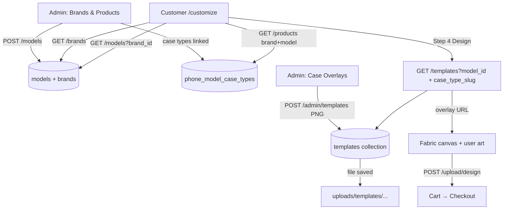
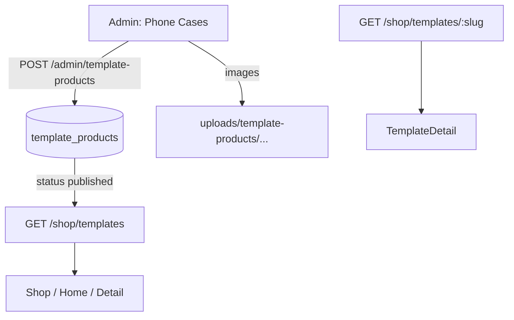

# Template & Customize Workflow

This project has **two separate “template” systems**. They look related but feed different pages.

| System | Admin menu | Purpose | Customer surface |
|--------|------------|---------|------------------|
| **Case overlays** | Catalog → Case Overlays | PNG frame for the live customizer | `/customize` Design step |
| **Phone cases (shop)** | Catalog → Phone Cases | Ready-made product listings | `/shop`, home featured, product detail |
| **Brands / models** | Catalog → Brands & Products | Phone catalog | Customize steps 1–3 |

---

## 1. Customize flow (user designs their own case)

**Admin path:** Catalog → Brands & Products + Case Overlays  
**Customer path:** `/customize`

### Flow diagram



### Customer steps (`frontend/src/pages/Customize.jsx`)

1. **Brand** → `GET /brands`
2. **Model** → `GET /models?brand_id=…`
3. **Case type** → `GET /products?brand_id&model_id` (only types enabled for that model)
4. **Design** → `GET /templates?model_id=&case_type_slug=`
   - Loads the PNG overlay from `uploads/templates/…`
   - User drops art → `POST /upload/design`
   - Add to cart with `template_id` (overlay id), **not** a shop product id

Draft selections are kept in `sessionStorage` via `frontend/src/lib/draft.js`.

### Admin: upload / update overlay

| Item | Detail |
|------|--------|
| UI | `/admin/catalog/templates` (“Case Overlays”) — `frontend/src/pages/admin/Templates.js` |
| Create / replace | `POST /admin/templates` |
| Body | `brand_id`, `model_id`, `case_type_slug`, PNG file, canvas size, print/mask zones |
| Same model + case type again | **Update** (version++, old file path archived) |
| Other actions | Clone (`POST /admin/templates/:id/clone`), enable/disable (`PATCH`), delete (`DELETE`) |

**How it reaches Customize:** once saved with `enabled: true`, the Design step finds it by `model_id` + `case_type_slug`.

Public lookup:

```http
GET /api/templates?model_id=<id>&case_type_slug=<slug>
```

Overlay image URL helper: `frontend/src/lib/templateImage.js` → `getTemplateImageUrl(file_path)`.

### Storage

- MongoDB collection: `templates`
- Files: `backend/uploads/templates/`
- Served at: `/api/uploads/templates/...`

---

## 2. Shop ready-made cases (admin “Phone Cases”)

**Admin path:** Catalog → Phone Cases  
**Customer path:** `/shop`, home featured row, `/shop/:slug` (or template detail route)

### Flow diagram



### Admin upload / update

| Item | Detail |
|------|--------|
| UI | `/admin/template-products` — `frontend/src/pages/admin/AdminTemplateProducts.jsx` |
| Create | `POST /admin/template-products` |
| Update | `PUT /admin/template-products/:id` |
| Fields | title, price, case type, `product_type` (`customized` \| `original`), images, status |
| Other | publish / trash / restore / feature / duplicate / bulk |

### How it shows on the site

Only products with **`status: "published"`** and **not trashed** appear publicly.

| Surface | API |
|---------|-----|
| Shop listing | `GET /shop/templates` |
| Featured (home) | `GET /shop/templates/featured` |
| Product detail | `GET /shop/templates/:slug` |
| Filters meta | `GET /shop/templates/meta` |

Cart line for these uses `template_product_id`. Customize cart lines use design URLs + overlay `template_id` instead.

### Storage

- MongoDB collection: `template_products`
- Files: `backend/uploads/template-products/`
- Served at: `/api/uploads/template-products/...`

Helpers / parsing: `backend/lib/templateProducts.js`.

---

## 3. Admin models upload → Customize

Admin UI: `/admin/catalog` (“Brands, Models & Products”) — `frontend/src/pages/admin/AdminCatalog.jsx`

| Action | API | Lands on customer |
|--------|-----|-------------------|
| Add brand | `POST /brands` | Customize step 1 |
| Add model + image | `POST /models` → `uploads/models/` | Customize step 2 |
| Enable case types on model | `phone_model_case_types` | Customize step 3 |
| Upload case overlay PNG | `POST /admin/templates` | Customize step 4 canvas |
| Upload shop product images | `POST /admin/template-products` | Shop / home (if published) |

**Important:** adding a model alone does **not** create an overlay. You still need a **Case Overlay** for that model + case type, or the Design step has no frame (`404` / `no_template`).

Model image files: `backend/uploads/models/`.

---

## Quick map

| What admin uploads | Admin menu | DB / folder | Customer sees it |
|--------------------|------------|-------------|------------------|
| Phone brand / model | Brands & Products | `brands`, `models` / `uploads/models` | Customize steps 1–2 |
| Case overlay PNG | Case Overlays | `templates` / `uploads/templates` | Customize Design canvas |
| Ready-made case listing | Phone Cases | `template_products` / `uploads/template-products` | Shop / home (if published) |

---

## Key API routes (backend `server.js`)

### Overlays (customizer)

| Method | Path | Auth | Role |
|--------|------|------|------|
| GET | `/templates` | public | lookup by model + case type |
| GET | `/admin/templates` | admin | list all |
| POST | `/admin/templates` | admin | create or replace |
| POST | `/admin/templates/:id/clone` | admin | copy to another model |
| PATCH | `/admin/templates/:id` | admin | enable / disable |
| DELETE | `/admin/templates/:id` | admin | delete |

### Shop products

| Method | Path | Auth | Role |
|--------|------|------|------|
| GET | `/shop/templates` | public | published list |
| GET | `/shop/templates/featured` | public | featured |
| GET | `/shop/templates/:slug` | public | detail + related |
| GET | `/admin/template-products` | admin | list (incl. drafts/trash) |
| POST | `/admin/template-products` | admin | create |
| PUT | `/admin/template-products/:id` | admin | update |

### Catalog

| Method | Path | Auth | Role |
|--------|------|------|------|
| GET | `/brands`, `/models`, `/products` | public | customize catalog |
| POST | `/models` | admin | create model (+ optional image) |
| PATCH | `/models/:id` | admin | update model |

---

## Troubleshooting

| Symptom | Likely cause |
|---------|----------------|
| Customize has no brands/models | Nothing in `brands` / `models`, or backend not running |
| Step 3 empty (“No active case types”) | Case types not linked/enabled for that model |
| Design step has no phone frame | No enabled overlay for that `model_id` + `case_type_slug` |
| Shop empty after admin upload | Product left as `draft`, or moved to trash |
| Overlay uploaded but wrong case type | Overlay keyed by `case_type_slug`; must match product slug used in Customize |
